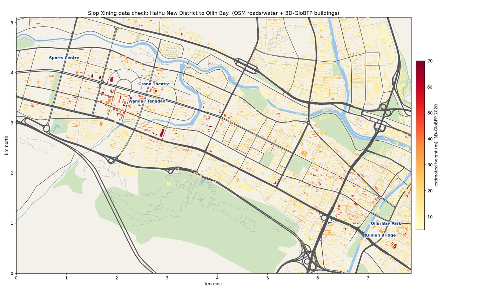
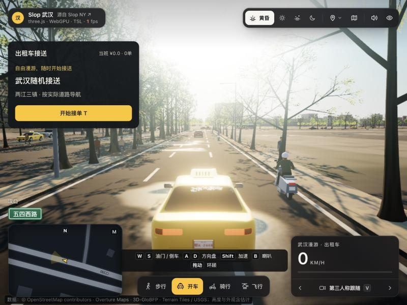
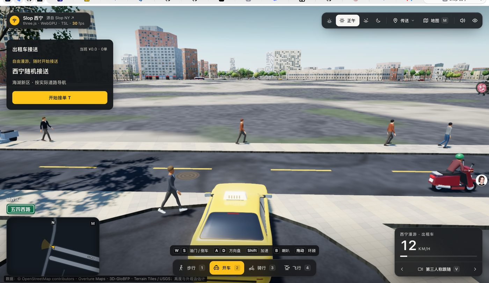
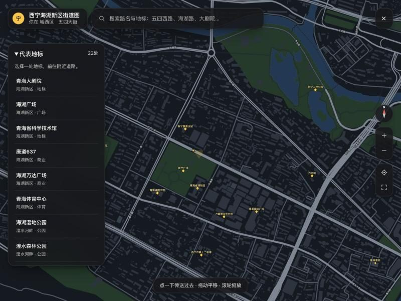
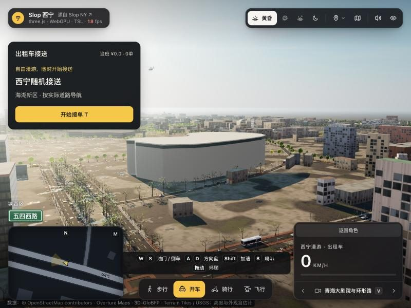

> 在线体验：[liuzr-523.github.io/slop-xining](https://liuzr-523.github.io/slop-xining/)　源码：[Liuzr-523/slop-xining](https://github.com/Liuzr-523/slop-xining)
>
> 需要支持 WebGPU 的浏览器（新版 Chrome / Edge，或较新的 Safari）。第一次进入要编译着色器，等半分钟。

## 起因

three.js 的作者 mrdoob 最近放出了一个叫 **Slop New York** 的项目：在浏览器里 1:1 还原曼哈顿，可以步行、开出租车、骑车、开直升机。他在 README 里写着「Fork it, remix it」，一个礼拜里就冒出了几十个别的城市版本，上海、武汉、广州、台北都有。

我想要一个**西宁**的。范围定在**海湖新区到麒麟湾**：海湖新区是新城，高楼多，环形路一圈有大剧院和科技馆；往东顺着五四大街、西关大街一路到麒麟湾，湟水河正好给场景一条水岸线。东西大约 7.9 公里，南北 5.1 公里。

这件事几乎全程是我和 Claude 一起做的：我定方向、看效果、挑毛病，它读代码、处理数据、改程序。

## 选底子：不从纽约原版改

原版的代码和曼哈顿绑得很死：坐标系按曼哈顿的棋盘路网转了 29°，街道配置围绕「编号街 + 大道」写，楼高来自纽约市政府的开放数据。西宁是沿湟水河谷展开的不规则路网，这套直接用不了。

所以去 [Slop Cities](https://github.com/zz85/slop-cities) 这个合集里找已经解决了「不规则路网」的国内版本，比了两个：

| | 武汉版 | 广州版（珠江新城） |
|:--|:--|:--|
| 路网 | OSM，不规则 | OSM，不规则 |
| 缺楼高时 | 用 3D-GloBFP 遥感估高补 | 约 98% 的楼按 18 米或层数估 |
| 范围 | 一个配置文件定经纬度 | 写死在脚本里 |

决定性的是楼高。海湖新区好看就好看在高楼，如果全按 18 米拉，就是一片平房。最后选了**武汉版**做底子。

## 数据：OSM 里的西宁几乎没有楼

先把这一片的数据拉下来数了一遍：

- **OpenStreetMap**：路网很全（1019 条路），但建筑只有 922 栋，**带楼层信息的只有 15 栋**
- **Overture Maps**：卫星影像识别出的建筑轮廓 11,669 栋，覆盖均匀
- **3D-GloBFP**（中山大学，2020 年）：15,154 栋的遥感估算楼高，和 Overture 的轮廓 97% 能对上

*数据检查图：建筑都落在路网围出的街区里，说明没有坐标偏移*

这里有个坑：**高德、苹果这些国内地图的数据不能直接拿来用**。一是服务条款不允许抓取再利用，二是国内地图的坐标是加过偏移的，和 OSM 差几百米。街景可以看着当参考，但图片不能搬进项目。

## 第一次跑起来，卡在「正在初始化」

改完配置、生成完数据，双击启动脚本，页面一直停在「正在初始化 WebGPURenderer 与 TSL 着色器…」。

- **我以为是**：电脑太慢，在编译
- **实际是**：页面根本没加载起来。武汉版要先用 Vite 打包才能运行，我是直接用 `python3 -m http.server` 开源码，浏览器不认识 `import ... from 'three/webgpu'` 这种写法，第一步就静默失败了

解决办法是在 `index.html` 最前面加一段 importmap，告诉浏览器去项目自带的 `vendor/three` 里找。中间又踩了两个小坑：importmap 必须放在所有 `modulepreload` 之前，不然不生效；有个 CSS 文件是从 JS 里 import 的，只有打包工具认，得改成 `<link>`。

最后还有一个：Safari 会死死缓存旧脚本，改完要按 **⌥⌘R** 强制刷新才看得到。

*第一次跑起来。路、楼、车流、行人都有了，但面板上还写着「武汉随机接送」*

## 武汉痕迹和「广场上没有楼」

跑起来以后我挑了三个毛病：到处还是武汉的字样；有些楼根本不对；地图太简陋。

武汉字样一轮一轮地清：左下角的「汉口」换成「城西区」，传送点、相机机位、地图搜索都换成西宁的地点。

「楼不对」这个更有意思。出生点往西看，环形路圈里是一大片空地，但现实里那里明明有很多建筑：

*我截的图：出生点往西，海湖广场一带空空的*

查下来，楼不是处理时丢的，而是**所有数据源里都没有**：Overture 和 GloBFP 用的卫星影像比这些楼还旧。后来又找到清华的 **CMAB** 数据集（2023 年 2 月的影像），补进来 1,326 栋，总数到了 12,531 栋，但环形路圈内还是空的。这一圈只能以后照着照片手工建模了。

## 把地图上的地方标清楚

我在卫星图上圈出了大剧院、科学技术馆、新宁广场、力盟商业步行街这些地方，让它们在游戏地图里标出来。

标注的坐标全部取自 OSM，我的截图只用来核对位置有没有放对。OSM 里没有「力盟商业步行街」这条街本身，就取了力盟101大厦和力盟商业巷和熙楼两栋楼的中点。现在地图上有 22 个地点，点一下就能传送过去。

*西关大街一带的标注，位置和卫星图对得上*

大剧院目前还只是按真实轮廓拉起来的一个占位体块：

*「青海大剧院与环形路」机位。左边那块浅色的就是占位的大剧院*

## 上线：为什么不能让朋友直接连我电脑

想给朋友玩，第一反应是让他们连我电脑上的 `http://192.168.x.x:8765`。不行：浏览器**只允许 https 网址或本机地址使用 WebGPU**，局域网的 http 地址会直接被拦。

所以放到了 GitHub Pages 上。还顺手把武汉版自带的两个 GitHub Actions 改成了手动触发，不然每推一次就会跑一遍武汉的测试，必然失败，还会给我发报错邮件。

## 工具替我做了多少，我自己做了多少

**Claude 替我干的**：读懂武汉版的数据管线、写补丁脚本把它改成按配置生成西宁、拉数据和做统计、查「卡在初始化」的原因、找到 CMAB 这个数据源、整理仓库和发布版。

**我自己定的**：

- 做哪个城市、哪一片，哪几处必须做好（环形路一圈、唐道637、力盟步行街）
- 一眼看出「这里应该有楼」「这里还是武汉」——这些它在截图之外是看不到的
- 在卫星图上认出哪栋是大剧院

**中间被拦下来、必须我自己点的**：在我的电脑上运行从外部下载的脚本、新建一个公开的 GitHub 仓库、打开网络访问。这些它都停下来问我，没有自己绕过去。一开始觉得麻烦，后来觉得这样是对的：这几件事都是「做了就收不回来」的。

## 还没做完的

- 环形路圈内的建筑（大剧院、科技馆等）照着照片手工建模
- 力盟商业步行街的街景细节
- 桥和高架现在是平铺在地面上的，南北两山也还没有
- 出租车接单的目的地里可能还有武汉的地名

数据来源：© OpenStreetMap contributors（ODbL）、Overture Maps、3D-GloBFP（CC BY 4.0）、CMAB（CC BY 4.0）。代码基于 mrdoob/slop-newyork 与 LightYearZh/slop-wuhan，MIT 许可。
